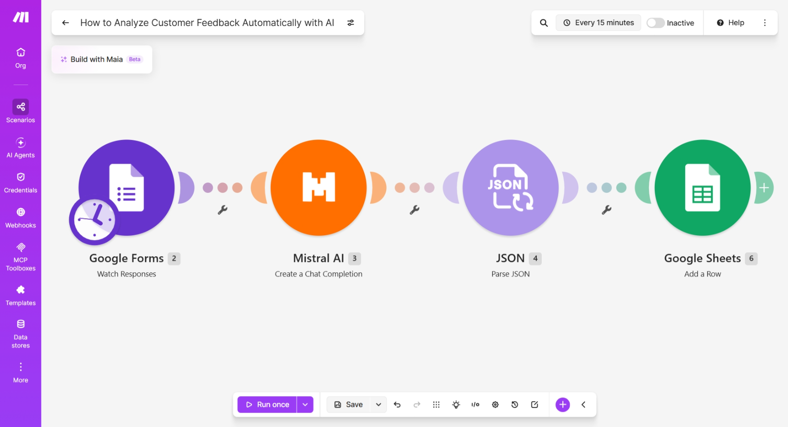

# How to Analyze Customer Feedback Automatically with AI

A [Make.com](https://www.make.com) scenario that collects customer feedback from a Google Form, uses an AI model (Mistral) to detect the sentiment, write a short summary and pick a category, then logs everything in a Google Sheet.

▶️ **Video tutorial:** [watch on YouTube](https://www.youtube.com/watch?v=gPt_aprsxeQ)

[](https://www.youtube.com/watch?v=gPt_aprsxeQ)

## The scenario



```
Google Forms (new response) ──► Mistral AI (analyze feedback as JSON) ──► Parse JSON ──► Google Sheets (add row)
```

## What it does

1. **Watch responses** (Google Forms): checks your form for new submissions.
2. **Analyze the feedback** (Mistral AI, `mistral-medium-latest`): sends the customer's answer to the model with a system prompt (see [`prompt.md`](prompt.md)). The model returns a JSON object with:
   - `sentiment`: overall sentiment (`Positive`, `Negative`, `Neutral` or `Mixed`)
   - `summary`: one neutral, factual sentence (max 20 words)
   - `category`: main topic (`Product`, `Support`, `Pricing`, `Delivery`, `Ambiance` or `Other`)
   - `sentences`: each sentence of the feedback with its own sentiment
3. **Parse JSON**: turns the model's reply into structured data.
4. **Add a row** (Google Sheets): logs the response and the analysis in your spreadsheet.

> **The AI can make mistakes.** The sentiment, summary and category are generated by an AI model and can be wrong, especially with short, ironic or ambiguous feedback. Check the results before relying on them, for example by reading a sample of rows in your sheet from time to time.

## Requirements

- A Make.com account (the free plan is enough to try it)
- A Google account (Forms + Sheets)
- A Mistral AI API key ([console.mistral.ai](https://console.mistral.ai))

## Google Form setup

Create a form with two questions:

| Question                                                     | Type          |
|--------------------------------------------------------------|---------------|
| How would you rate your overall experience?                  | Rating / grid |
| Tell us about your experience with our product and service.  | Paragraph     |

## Google Sheet setup

Create a spreadsheet with a header row, in this order:

| Column | Header    | Filled with                    |
|--------|-----------|--------------------------------|
| A      | Date      | Date the response was processed |
| B      | Rating    | Answer to the rating question  |
| C      | Feedback  | The customer's text            |
| D      | Sentiment | `sentiment` from the AI        |
| E      | Summary   | `summary` from the AI          |
| F      | Category  | `category` from the AI         |

## Installation

1. Download [`Customer Feedback Analysis.blueprint.json`](Customer%20Feedback%20Analysis.blueprint.json).
2. In Make, create a new scenario, open the **⋯** menu, choose **Import Blueprint** and select the file.
3. Reconnect each module to your own accounts:
   - **Google Forms**: add your Google connection, then pick **your** form.
   - **Mistral AI**: add a connection with your API key.
   - **Google Sheets**: add your Google connection, then pick **your** spreadsheet and sheet.
4. Remap the form answers: your questions have different IDs from the original form, so update the fields that point to the answers in the **Mistral AI** module (user message) and in the **Google Sheets** module (columns B and C).
5. In the **Parse JSON** module, rebuild the data structure if Make asks for it (an object with `sentiment`, `summary`, `category`, `sentences`).
6. Click **Run once** and submit a test response, for example:
   > The product works great and setup was easy, but delivery took almost two weeks.
7. Turn on scheduling when you are happy with the result.

## Customizing

- **Prompt**: change the analysis rules in the Mistral module. [`prompt.md`](prompt.md) has a readable copy of the prompt used in the scenario.
- **Categories**: edit the list of categories in the prompt to match your business.
- **Model**: any Mistral model works. A lower `temperature` (for example `0.2`) gives more consistent classification.
- **Other sources**: swap Google Forms for Typeform, Tally, emails, app reviews, etc.
- **Alerts**: add a filter after Parse JSON to send a Slack or email alert when the sentiment is `Negative`.

## Privacy and security

- **Customer feedback is sent to Mistral AI** for processing. Don't send personal data you are not allowed to share with a third-party AI provider, and tell your customers how their answers are processed.
- **No credentials are included in this repository.** API keys and OAuth tokens stay in your Make connections and are never exported in the blueprint. Form and spreadsheet IDs have been replaced with placeholders.
- **Feedback is untrusted input.** A customer could write text designed to trick the AI (prompt injection) and skew the result. In this scenario the impact is limited to rows in your spreadsheet, but don't automate important decisions on the AI's output alone.

## License

[MIT](LICENSE)
